<section class="about" id="about">
  
I am a computer scientist on a startup quest as a co-founder of <a href="https://moverse.ai/" target="_blank" rel="noopener">Moverse</a>.

  
Previously I was postdoctoral researcher at the <a href="https://www.eng.ed.ac.uk/research/institutes/idcom" target="_blank" rel="noopener">University of Edinburgh</a> and adjunct professor (for a year) at the <a href="https://www.e-ce.uth.gr/?lang=en" target="_blank" rel="noopener">University of Thessaly</a> (UTH). I received my Diploma in computer engineering (2013), my M.Sc. cum laude in computer science (2015), and my Ph.D. from UTH (2020).

  
My research interests lie in the intersection of representation learning and computer vision. Now I'm focusing on generative AI for human motion.

</section>

<section class="news" id="news">
  <h2>News</h2>
  <ul class="timeline">
    <li><time>Dec &rsquo;24</time>Presenting our poster paper on controlling the diversity of single-shot motion synthesis @<a href="https://asia.siggraph.org/2024/" target="_blank" rel="noopener">SIGGRAPH Asia 2024</a>.</li>
    <li><time>Jul &rsquo;24</time>Our real-time markerless motion capture will be live @<a href="https://ai3dg.github.io/" target="_blank" rel="noopener">SIGGRAPH 2024</a>.</li>
    <li><time>Jun &rsquo;24</time>Presenting our work on practical single-shot motion synthesis @<a href="https://ai3dg.github.io/" target="_blank" rel="noopener">AI for 3D Generation, CVPR 2024</a>.</li>
    <li><time>Mar &rsquo;24</time>Reviewing for <a href="https://eccv2024.ecva.net/" target="_blank" rel="noopener">ECCV 2024</a>.</li>
    <li><time>Dec &rsquo;23</time>Presenting a demo @<a href="https://www.cvmp-conference.org/2023/" target="_blank" rel="noopener">CVMP 2023</a>.</li>
    <li><time>Oct &rsquo;23</time>Presenting a demo and a workshop paper @<a href="https://iccv2023.thecvf.com/" target="_blank" rel="noopener">ICCV 2023</a>.</li>
  </ul>
</section>

<section class="publications" id="publications">
  <h2>Highlighted Publications</h2>

  <article class="paper" id="tselepi2024singleshot">
    
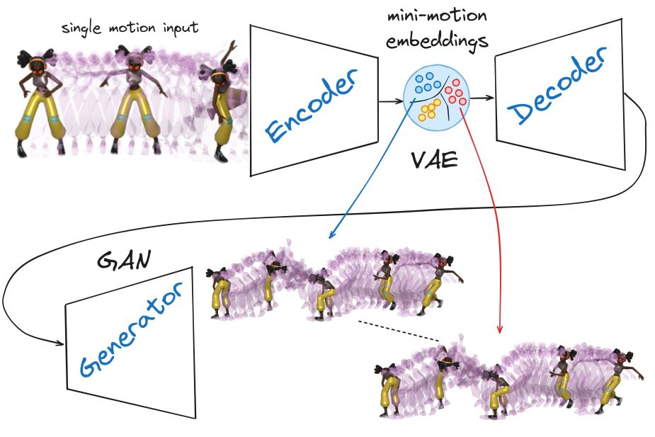

    

      <h3><a href="https://dl.acm.org/doi/pdf/10.1145/3681756.3697909" target="_blank" rel="noopener">Controlling Diversity in Single-shot Motion Synthesis</a></h3>
      
E. Tselepi, <strong>S. Thermos</strong>, G. Albanis, A. Chatzitofis

      
SIGGRAPH Asia, 2024

      

        <a href="https://moverseai.github.io/single-shot/" target="_blank" rel="noopener">project page</a>
        <button type="button" class="togglebib" onclick="togglebib('tselepi2024singleshot')">bibtex</button>
      

      <pre>@inproceedings{tselepi2024singleshot,
  author    = {Tselepi, Eleni, and Thermos, Spyridon, and Albanis, Georgios and Chatzitofis, Anargyros},
  title     = {Controlling Diversity in Single-shot Motion Synthesis},
  booktitle = {SIGGRAPH Asia (Posters)},
  month     = {December},
  year      = {2024}
}</pre>
    

  </article>

  <article class="paper" id="roditakis2024synthesis">
    
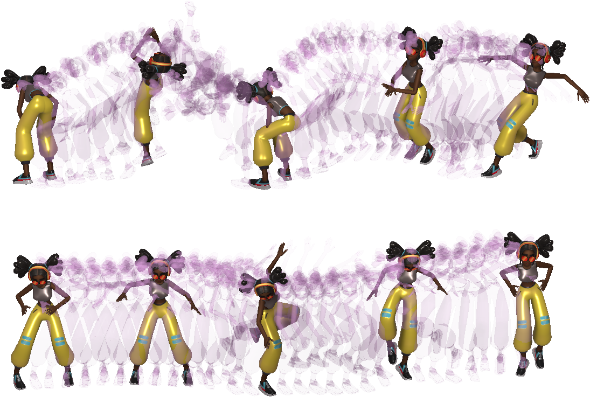

    

      <h3><a href="https://ai3dg.github.io/papers/paper_15.pdf" target="_blank" rel="noopener">Towards Practical Single-Shot Motion Synthesis</a></h3>
      
K. Roditakis, <strong>S. Thermos</strong>, N. Zioulis

      
CVPRW, 2024

      

        <a href="https://moverseai.github.io/single-shot/" target="_blank" rel="noopener">project page</a>
        <button type="button" class="togglebib" onclick="togglebib('roditakis2024synthesis')">bibtex</button>
      

      <pre>@inproceedings{roditakis2024synthesis,
  author    = {Roditakis, Konstantinos, and Thermos, Spyridon, and Zioulis, Nikolaos.},
  title     = {Towards Practical Single-Shot Motion Synthesis},
  booktitle = {IEEE/CVF Computer Vision and Pattern Recognition (CVPR) AI for 3D Generation Workshop},
  year      = {2024}
}</pre>
    

  </article>

  <article class="paper" id="albanis2023noise">
    
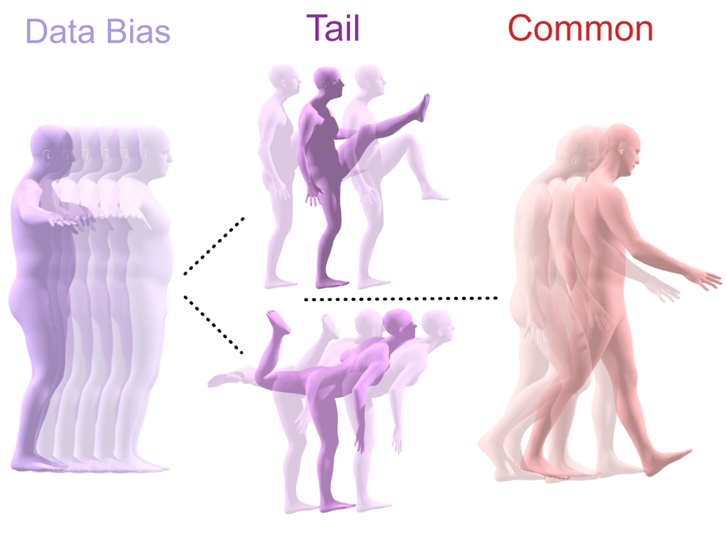

    

      <h3><a href="https://openaccess.thecvf.com/content/ICCV2023W/CV4Metaverse/html/Albanis_Noise-in_Bias-out_Balanced_and_Real-Time_MoCap_Solving_ICCVW_2023_paper.html" target="_blank" rel="noopener">Noise-in, Bias-out: Balanced and Real-time MoCap Solving</a></h3>
      
G. Albanis, N. Zioulis, <strong>S. Thermos</strong>, A. Chatzitofis, K. Kolomvatsos

      
ICCVW, 2023

      

        <a href="https://moverseai.github.io/noise-tail/" target="_blank" rel="noopener">project page</a>
        <button type="button" class="togglebib" onclick="togglebib('albanis2023noise')">bibtex</button>
      

      <pre>@inproceedings{albanis2023noise,
  author    = {Albanis, Georgios, and Zioulis, Nikolaos, and Thermos, Spyridon, and Chatzitofis, Anargyros and Kolomvatsos, Kostas.},
  title     = {Noise-in, Bias-out: Balanced and Real-time MoCap Solving},
  booktitle = {Proceedings of the IEEE/CVF International Conference on Computer Vision (ICCV) Workshops},
  year      = {2023}
}</pre>
    

  </article>

  <article class="paper" id="chatzitofis2023siggraph">
    
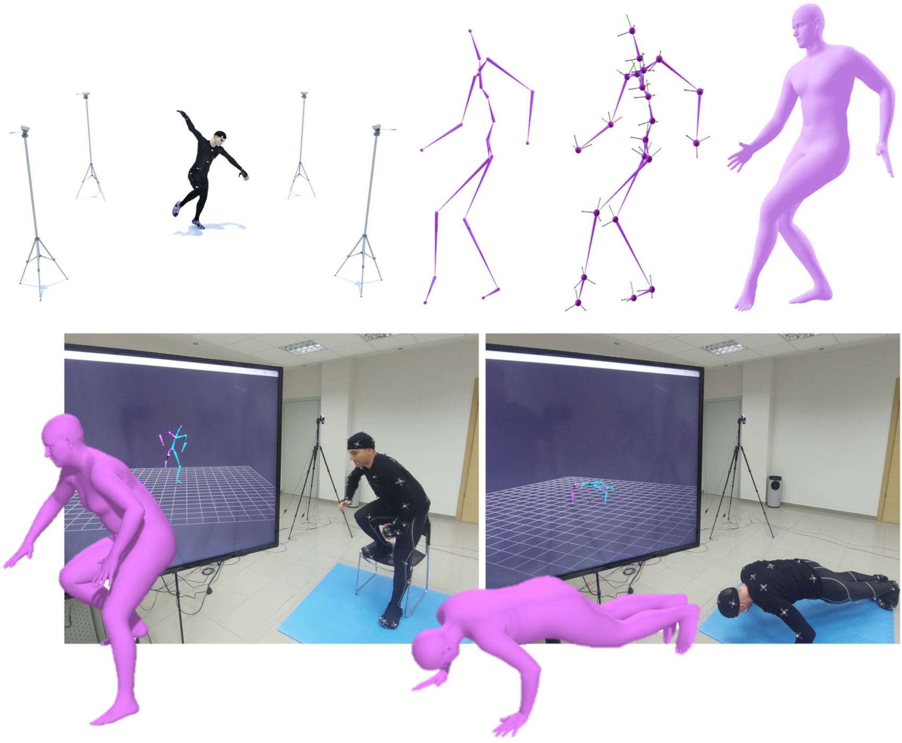

    

      <h3><a href="https://dl.acm.org/doi/abs/10.1145/3588430.3597249" target="_blank" rel="noopener">Suit Up: AI MoCap</a></h3>
      
A. Chatzitofis, G. Albanis, N. Zioulis, <strong>S. Thermos</strong>

      
SIGGRAPH, 2023

      

        <a href="https://www.youtube.com/watch?v=JLxqiMCrdwE" target="_blank" rel="noopener">video</a>
        <a href="https://s2023.siggraph.org/presentation/?id=real_113&sess=sess258" target="_blank" rel="noopener">project page</a>
        <button type="button" class="togglebib" onclick="togglebib('chatzitofis2023siggraph')">bibtex</button>
      

      <pre>@inproceedings{chatzitofis2023siggraph,
  author    = {Anargyros Chatzitofis and Georgios Albanis and Nikolaos Zioulis and Spyridon Thermos.},
  title     = {Suit Up: AI MoCap},
  booktitle = {ACM SIGGRAPH 2023 Real-Time Live!},
  year      = {2023}
}</pre>
    

  </article>

  <article class="paper" id="liu2022tutorial">
    
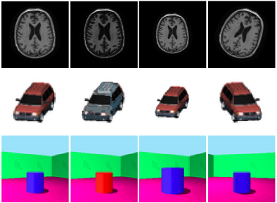

    

      <h3><a href="https://arxiv.org/abs/2108.12043?context=cs" target="_blank" rel="noopener">Learning disentangled representations in the imaging domain</a></h3>
      
X. Liu, P. Sanchez, <strong>S. Thermos</strong>, A. O'Neil, S. A. Tsaftaris

      
Medical Image Analysis, 2022

      

        <a href="https://github.com/vios-s/disentanglement_tutorial" target="_blank" rel="noopener">repo</a>
        <button type="button" class="togglebib" onclick="togglebib('liu2022tutorial')">bibtex</button>
      

      <pre>@article{liu2022tutorial,
  author       = "Xiao Liu and Pedro Sanchez and Spyridon Thermos and Alison O'Neil and Sotirios A. Tsaftaris",
  title        = "Learning Disentangled Representations in the Imaging Domain",
  journal      = "Medical Image Analysis",
  volume       = "80",
  pages        = "102516",
  year         = "2022"}</pre>
    

  </article>

  <article class="paper" id="liu2021metrics">
    
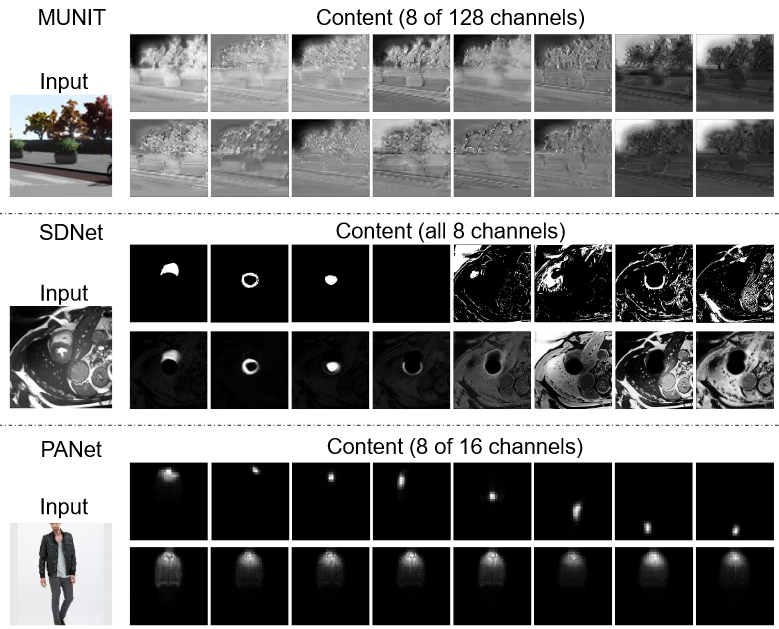

    

      <h3><a href="https://arxiv.org/pdf/2008.12378.pdf" target="_blank" rel="noopener">Measuring the Biases and Effectiveness of Content-Style Disentanglement</a></h3>
      
X. Liu, <strong>S. Thermos</strong>, G. Valvano, A. Chartsias, A. O'Neil, S. A. Tsaftaris

      
BMVC, 2021

      

        <a href="https://github.com/vios-s/CSDisentanglement_Metrics_Library" target="_blank" rel="noopener">repo</a>
        <button type="button" class="togglebib" onclick="togglebib('liu2021metrics')">bibtex</button>
      

      <pre>@inproceedings{liu2021metrics,
  author       = "Xiao Liu and Spyridon Thermos and Gabriele Valvano and Agisilaos Chartsias and Alison O'Neil and Sotirios A. Tsaftaris",
  title        = "Measuring the Biases and Effectiveness of Content-Style Disentanglement",
  booktitle    = "BMVC",
  year         = "2021"}</pre>
    

  </article>

  <article class="paper" id="thermos2021miccai">
    
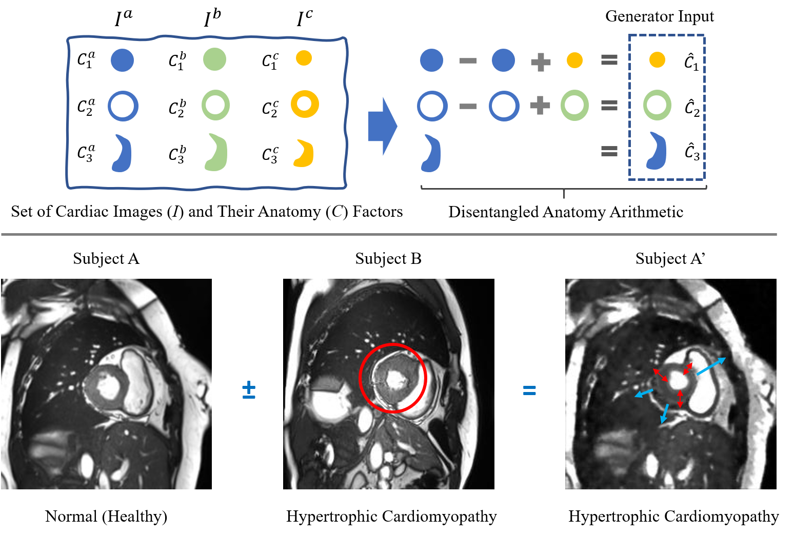

    

      <h3><a href="https://arxiv.org/abs/2107.01748" target="_blank" rel="noopener">Controllable cardiac synthesis via disentangled anatomy arithmetic</a></h3>
      
<strong>S. Thermos</strong>, X. Liu, A. O'Neil, S. A. Tsaftaris

      
MICCAI, 2021 oral

      

        <a href="https://github.com/vios-s/DAA-GAN" target="_blank" rel="noopener">repo</a>
        <button type="button" class="togglebib" onclick="togglebib('thermos2021miccai')">bibtex</button>
      

      <pre>@inproceedings{thermos2021miccai,
  author       = "Spyridon Thermos and Xiao Liu and Alison O'Neil and Sotirios A. Tsaftaris",
  title        = "Controllable cardiac synthesis via disentangled anatomy arithmetic",
  booktitle    = "International Conference on Medical Image Computing and Computer-Assisted Intervention (MICCAI)",
  pages        = "",
  year         = "2021"}</pre>
    

  </article>

  <article class="paper" id="sterzentsenko2020alignment">
    
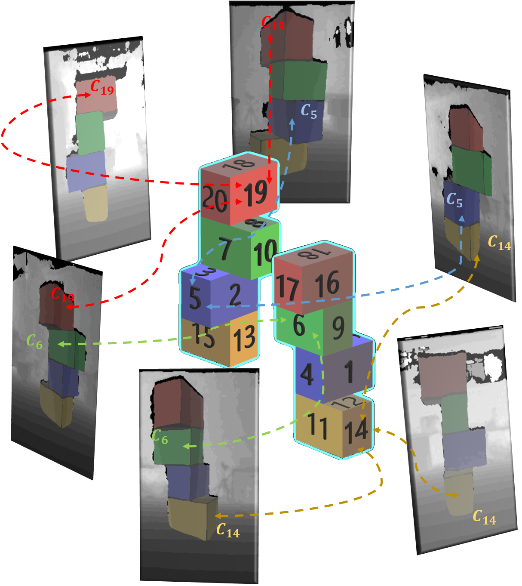

    

      <h3><a href="https://arxiv.org/abs/2003.10176.pdf" target="_blank" rel="noopener">Deep Soft Procrustes for Markerless Volumetric Sensor Alignment</a></h3>
      
V. Sterzentsenko, A. Doumanoglou, <strong>S. Thermos</strong>, N. Zioulis, D. Zarpalas, P. Daras

      
IEEE VR, 2020

      

        <a href="https://vcl3d.github.io/StructureNet/" target="_blank" rel="noopener">project page</a>
        <a href="https://www.youtube.com/watch?time_continue=4&v=0l5neSMt-2Y&feature=emb_logo" target="_blank" rel="noopener">video</a>
        <button type="button" class="togglebib" onclick="togglebib('sterzentsenko2020alignment')">bibtex</button>
      

      <pre>@inproceedings{sterzentsenko2020alignment,
  author       = "Vladimiros Sterzentsenko and Alexandros Doumanoglou and Spyridon Thermos and Nikolaos Zioulis and Dimitrios Zarpalas and Petros Daras",
  title        = "Deep Soft Procrustes for Markerless Volumetric Sensor Alignment",
  booktitle    = "Proc. IEEE VR",
  year         = "2020"}</pre>
    

  </article>

  <article class="paper" id="thermos2020icassp">
    
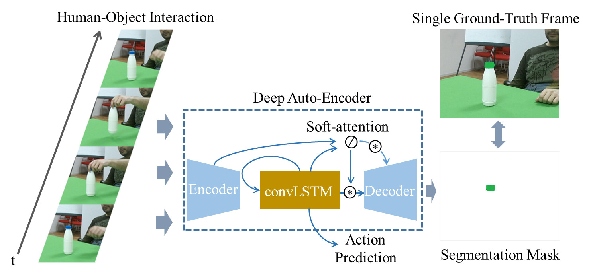

    

      <h3><a href="https://arxiv.org/abs/2004.08644.pdf" target="_blank" rel="noopener">A Deep Learning Approach To Object Affordance Segmentation</a></h3>
      
<strong>S. Thermos</strong>, P. Daras, G. Potamianos

      
ICASSP, 2020

      

        <a href="https://github.com/spthermo/STCAE" target="_blank" rel="noopener">repo</a>
        <a href="https://drive.google.com/open?id=1sBKOUZrQF1uASqLNpslOq7xi6BoF7E7L" target="_blank" rel="noopener">video</a>
        <button type="button" class="togglebib" onclick="togglebib('thermos2020icassp')">bibtex</button>
      

      <pre>@inproceedings{thermos2020icassp,
  author       = "Spyridon Thermos and Petros Daras and Gerasimos Potamianos",
  title        = "A Deep Learning Approach To Object Affordance Segmentation",
  booktitle    = "Proc. International Conference on Acoustics, Speech, and Signal Processing (ICASSP)",
  pages        = "2358-2362",
  year         = "2020"}</pre>
    

  </article>

  <article class="paper" id="sterzentsenko2019denoising">
    
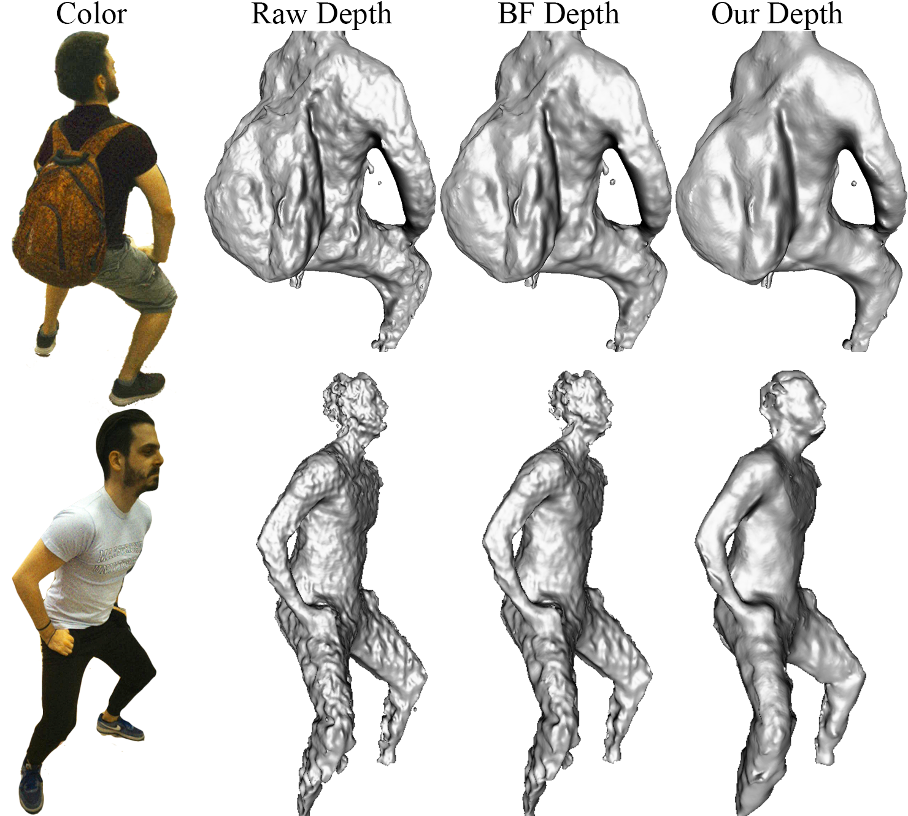

    

      <h3><a href="https://arxiv.org/pdf/1909.01193.pdf" target="_blank" rel="noopener">Self-Supervised Deep Depth Denoising</a></h3>
      
V. Sterzentsenko, L. Saroglou, A. Chatzitofis, <strong>S. Thermos</strong>, N. Zioulis, A. Doumanoglou, D. Zarpalas, P. Daras

      
ICCV, 2019

      

        <a href="https://arxiv.org/abs/1909.01193" target="_blank" rel="noopener">arxiv</a>
        <a href="https://vcl3d.github.io/DeepDepthDenoising/" target="_blank" rel="noopener">project page</a>
        <button type="button" class="togglebib" onclick="togglebib('sterzentsenko2019denoising')">bibtex</button>
      

      <pre>@inproceedings{sterzentsenko2019denoising,
  author       = "Vladimiros Sterzentsenko and Leonidas Saroglou and Anargyros Chatzitofis and Spyridon Thermos and Nikolaos Zioulis and Alexandros Doumanoglou and Dimitrios Zarpalas and Petros Daras",
  title        = "Self-Supervised Deep Depth Denoising",
  booktitle    = "ICCV",
  pages        = "1242-1251",
  year         = "2019"}</pre>
    

  </article>

  <article class="paper" id="thermos2017cvpr">
    
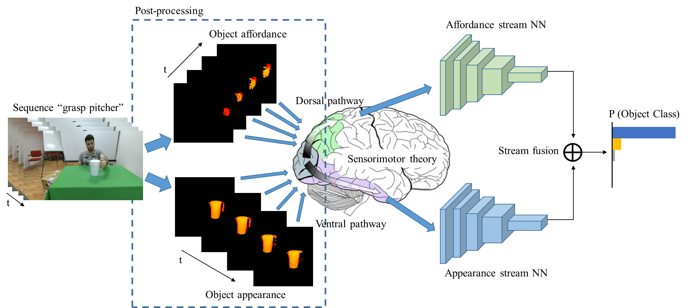

    

      <h3><a href="http://openaccess.thecvf.com/content_cvpr_2017/papers/Thermos_Deep_Affordance-Grounded_Sensorimotor_CVPR_2017_paper.pdf" target="_blank" rel="noopener">Deep Affordance-grounded Sensorimotor Object Recognition</a></h3>
      
<strong>S. Thermos</strong>, G.T. Papadopoulos, P. Daras, G. Potamianos

      
CVPR, 2017 spotlight

      

        <a href="https://arxiv.org/abs/1704.02787" target="_blank" rel="noopener">arxiv</a>
        <button type="button" class="togglebib" onclick="togglebib('thermos2017cvpr')">bibtex</button>
      

      <pre>@inproceedings{thermos2017cvpr,
  author       = "S. Thermos and G.T. Papadopoulos and P. Daras and G. Potamianos",
  title        = "Deep Affordance-grounded Sensorimotor Object Recognition",
  booktitle    = "CVPR",
  pages        = "6167-6175",
  year         = "2017"}</pre>
    

  </article>
</section>

<section class="teaching" id="teaching">
  <h2>Teaching</h2>
</section>
